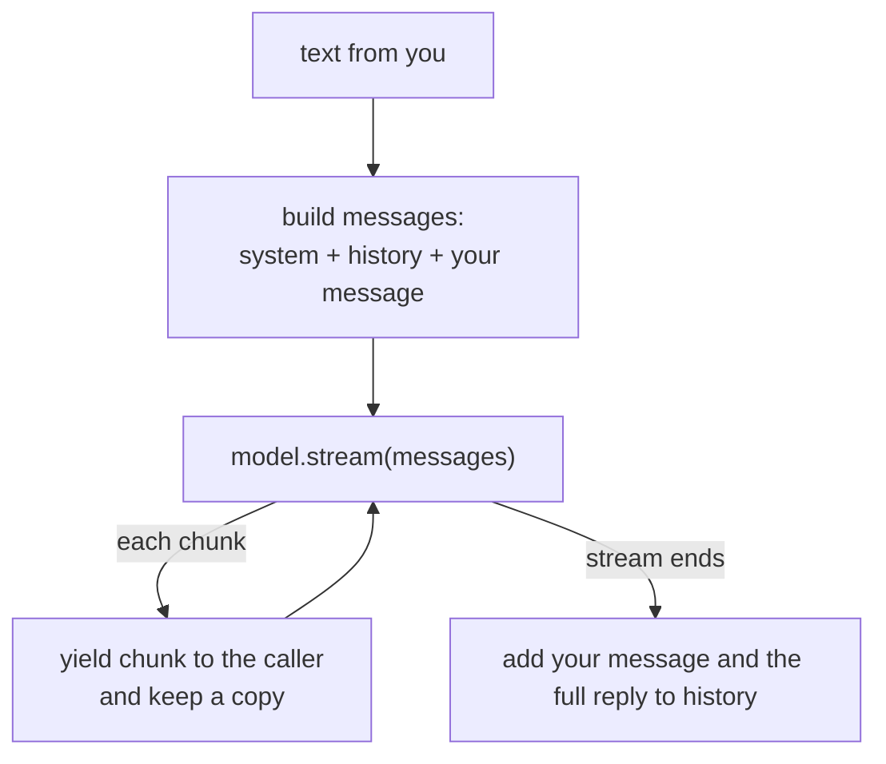
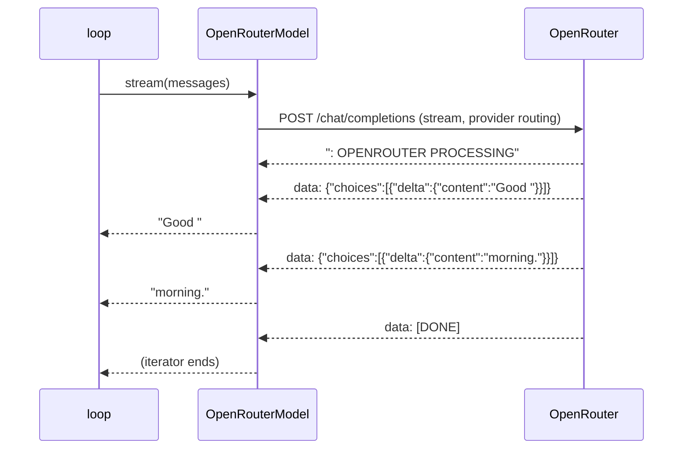
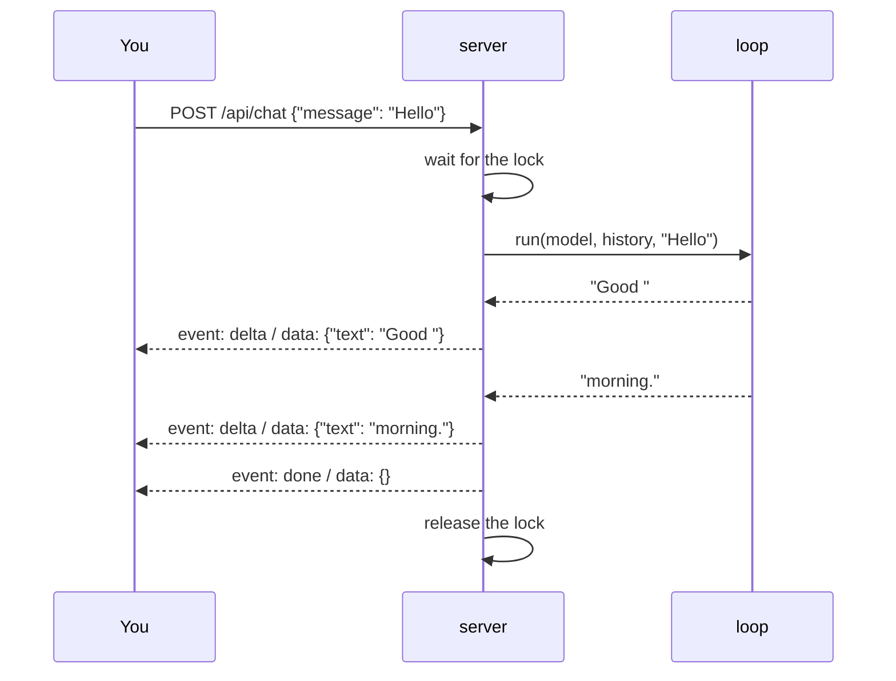

# Learning Homunculus

This document teaches the codebase from nothing. It assumes you know Python, and nothing about this project or about how agents are built.

There is one chapter per module, in the order the modules were built. Every chapter has the same six parts:

1. **The problem**: why the module exists.
2. **The idea**: the technique it uses and where that comes from.
3. **A picture**: one diagram.
4. **One value, traced**: a real input followed through every function, with each argument and return value shown.
5. **The test**: the test that defines what the module must do, read in plain English.
6. **Change it yourself**: one small edit you make by hand, to prove to yourself that you understand it.

Read a chapter with the code open beside it. Each one takes about fifteen minutes.

## Contents

1. [The loop](#1-the-loop)
2. [The model](#2-the-model)
3. [The server](#3-the-server)

---

## 1. The loop

Code: `src/homunculus/loop.py`. Tests: `tests/test_loop.py`.

### The problem

A language model is a function from text to text. On its own it remembers nothing between calls. It has no idea who it is working for, and it cannot do anything except write. An agent is the program wrapped around the model that gives it those things.

The loop is the centre of that program. Each time you say something, it decides what the model should see and passes back what the model says.

### The idea

Chat models do not take one string. They take a **list of messages**, each with a role:

| Role | Who wrote it | Example |
|---|---|---|
| `system` | The program, before the conversation starts | "You are Homunculus, a personal agent..." |
| `user` | You | "I like tea." |
| `assistant` | The model, in an earlier turn | "Noted." |

The model reads the whole list every time and writes the next `assistant` message. That is how it "remembers": the program sends the earlier turns again. Nothing is stored inside the model. This message format comes from OpenAI's Chat Completions API, and most providers now accept it, OpenRouter included.

The full agent loop has a second half, which comes in a later chapter. The model can reply with a request to use a tool instead of words. The loop runs the tool, adds the result to the list, and asks again, repeating until the model answers in words. This design is often called a ReAct-style loop, after the paper that named it ("ReAct: Synergizing Reasoning and Acting in Language Models", Yao et al., 2022). Today there are no tools, so the loop runs exactly one model turn and stops. **The stopping rule is already the real one: the loop is done when the model replies in words.**

### A picture



### One value, traced

Suppose this is your first message, and you send `"I like tea."`.

**`run(model, history, text)`** is called with:

```python
history = []                  # a list of message dicts; empty, since this is the first turn
text = "I like tea."          # a str
```

**Line: `user_message = {"role": "user", "content": text}`**

```python
user_message = {"role": "user", "content": "I like tea."}    # one message: a dict with two str keys
```

**Line: `messages = [{"role": "system", ...}, *history, user_message]`**

`*history` spreads the earlier turns into the list. There are none yet, so `messages` is a list of 2 dicts:

```python
messages[0] = {"role": "system", "content": "You are Homunculus, a personal agent working on behalf of your operator."}
messages[1] = {"role": "user",   "content": "I like tea."}
```

Read `messages[1]` aloud: "the user said: I like tea."

**`model.stream(messages)`** returns an async iterator of `str`. Suppose the model's reply arrives in one piece:

```python
model.stream(messages) -> "Noted."      # yields 1 chunk, then ends
```

**Inside the `async for`:** for that chunk, `parts.append("Noted.")` keeps a copy, so `parts == ["Noted."]`, a list of str. Then `yield "Noted."` hands the chunk to whoever called `run`. That is the server, in chapter 3. The chunk leaves the loop **before** the reply is finished. This is what makes the words appear as they are written.

**Last line: `history += [user_message, {"role": "assistant", "content": "".join(parts)}]`**

`"".join(["Noted."])` is `"Noted."`. `history` was `[]` and is now a list of 2 dicts:

```python
history[0] = {"role": "user",      "content": "I like tea."}
history[1] = {"role": "assistant", "content": "Noted."}
```

The system message is **not** stored in `history`. It is added fresh on every call, so changing `SYSTEM_PROMPT` affects every later turn.

**Now your second message, `"What do I like?"`.** `history` holds the 2 dicts above, so `messages` is a list of 4:

```python
messages[0]["role"] == "system"
messages[1] == {"role": "user",      "content": "I like tea."}
messages[2] == {"role": "assistant", "content": "Noted."}
messages[3] == {"role": "user",      "content": "What do I like?"}
```

The model sees the whole exchange and can answer "tea". That is the entire mechanism of conversation memory.

**Where each piece is used.** `parts` exists only inside one call to `run`. `history` outlives the call: the server owns it, and `run` only adds to it. `SYSTEM_PROMPT` is read by `run` and never stored anywhere.

**Why history is updated last.** If the model fails halfway through, `model.stream` raises an error inside the `async for`. Python leaves the function at that point, so the final line never runs and `history` stays as it was. A failed turn leaves no half-finished reply in the conversation.

### The test

```python
async def test_the_next_message_carries_the_earlier_exchange() -> None:
    model = ScriptedModel([["Noted."], ["You said you like tea."]])
    history: list[Message] = []

    await collect(model, history, "I like tea.")
    await collect(model, history, "What do I like?")

    second_call = model.received[1]
    assert [(m["role"], m["content"]) for m in second_call[1:]] == [
        ("user", "I like tea."),
        ("assistant", "Noted."),
        ("user", "What do I like?"),
    ]
```

In plain English: "Given a model that will answer 'Noted.' and then 'You said you like tea.', when I send two messages, the second call to the model includes the first exchange, in order."

`ScriptedModel` (in `tests/scripted_model.py`) is a stand-in for the real model. It replies from a script and records every message list it receives in `received`. Tests use it so they are instant, free and give the same result every run. It is the only thing faked. The loop under test is the real code.

The other two loop tests say: the loop streams the reply and calls the model exactly once when the model answers in words; and a reply that fails partway leaves `history` empty.

### Change it yourself

1. In `loop.py`, move the history update so that it runs **before** the model is called. Add `history.append(user)` just above `parts: list[str] = []`.
2. Run `uv run pytest tests/test_loop.py`.
3. Two tests fail. Read their failure messages. One shows your message appearing twice in the list sent to the model. The other shows a failed turn leaving your message behind in `history`.
4. Undo the change and run the tests again to see them pass.

You have just watched the tests do their job: they describe what the loop promises, and they caught a change that broke the promise.

---

## 2. The model

Code: `src/homunculus/model.py`. Tests: `tests/test_server.py` (the tests whose names mention providers and errors).

### The problem

The loop needs a reply from a real model. The model runs on someone else's servers, so getting a reply means an HTTP request over the internet. Two things make this harder than an ordinary request:

- A reply can take 15 seconds or more. Waiting for all of it before showing anything would feel broken.
- Your conversation is private. Where it goes, and whether anyone keeps it, matters.

### The idea

**OpenRouter** is a single API in front of many model providers. You send one request in the Chat Completions format, and OpenRouter picks a provider that serves the model you named. This project uses `z-ai/glm-5.3-flash`.

**Streaming with server-sent events (SSE).** With `"stream": true` in the request, the reply comes back as a stream of small text lines instead of one JSON document, sent as each piece is written. SSE is a web standard: each event is a line starting with `data: `, and events are separated by a blank line. OpenRouter's stream looks like this:

```
: OPENROUTER PROCESSING

data: {"choices": [{"delta": {"content": "Good "}}]}

data: {"choices": [{"delta": {"content": "morning."}}]}

data: [DONE]
```

- A line starting with `:` is a comment. OpenRouter sends these to keep the connection open while the model thinks. They carry no content.
- Each `data:` line holds one JSON chunk. The new text is at `choices[0].delta.content`. "Delta" means "only what changed since the last chunk".
- `data: [DONE]` marks the end.

**Privacy routing.** OpenRouter accepts a `provider` object that limits which providers may serve a request. `"zdr": true` allows only providers with zero data retention, meaning they keep no copy of your request. `"data_collection": "deny"` excludes providers that may train on it. This project sends both on every request, from a constant in the code. It is not a setting, so it cannot be switched off by mistake.

**Errors come two ways**, as OpenRouter's streaming docs describe:

- *Before the stream starts*: an HTTP status other than 200, such as 401 for a bad key or 402 for no credit, with a JSON body `{"error": {"message": ...}}`.
- *After it starts*: the status is already 200, so the error arrives as a chunk with a top-level `"error"` field.

Both become a `ModelError`, whose message is written to be shown to you.

### A picture



### One value, traced

The loop calls `stream` with the 2-message list from chapter 1, holding your `"Hello"`.

**`OpenRouterModel("sk-or-...")`** stores the key and makes an `httpx.AsyncClient`, which is the object that sends HTTP requests. Tests pass in their own client whose network is faked. The real program lets it make a normal one.

**`stream(messages)` builds `body`**, a dict that becomes the JSON request:

```python
body = {
    "model": "z-ai/glm-5.3-flash",
    "messages": messages,                                   # the list of 2 dicts
    "stream": True,
    "provider": {"zdr": True, "data_collection": "deny"},   # PRIVACY_ROUTING
}
```

**`self._client.stream("POST", URL, json=body, headers=headers)`** opens the request and hands back `response` as soon as the status line arrives, before the body has finished. Suppose `response.status_code == 200`, so the error branch is skipped.

**`response.aiter_lines()`** yields the body one line at a time, as each one arrives. Following each line through the loop body:

| Line received | What the code does | Yields |
|---|---|---|
| `": OPENROUTER PROCESSING"` | does not start with `data: `, so `continue` | nothing |
| `""` (blank separator) | does not start with `data: `, so `continue` | nothing |
| `'data: {"choices": [{"delta": {"content": "Good "}}]}'` | strips `data: `, `json.loads` gives a dict, no `"error"` key, loops over `chunk["choices"]` (a list of 1 dict) | `"Good "` |
| `'data: {"choices": [{"delta": {"content": "morning."}}]}'` | same | `"morning."` |
| `"data: [DONE]"` | `data == "[DONE]"`, so `return` | iterator ends |

Look at the third row closely. `json.loads(data)` returns `{"choices": [{"delta": {"content": "Good "}}]}`, so `chunk["choices"][0]["delta"]["content"]` is `"Good "`. The code reads it with `.get("content")` because some chunks carry a delta with no text, such as the final one. `if text := ...` skips those.

**Back in the loop**, `"Good "` and then `"morning."` arrive one at a time, and each is passed on to the server the moment it arrives.

**If the key were wrong**, `response.status_code` would be `401`. The code reads the body, and `_error_message` digs out `"No auth credentials"`. It raises `ModelError("Model request failed (401): No auth credentials")`. That exception travels up through the loop's `async for`, so history is not touched (chapter 1). The server turns it into an `error` event.

### The test

```python
def test_every_model_request_requires_private_providers() -> None:
    sent: list[dict[str, Any]] = []

    def network(request: httpx.Request) -> httpx.Response:
        sent.append(json.loads(request.content))
        return httpx.Response(200, text=openrouter_stream("Good ", "morning."))

    client = server(openrouter_model(network))
    first = chat(client, "Hello")
    chat(client, "And again")

    assert [data["text"] for name, data in first if name == "delta"] == ["Good ", "morning."]
    assert len(sent) == 2
    for body in sent:
        assert body["provider"] == {"zdr": True, "data_collection": "deny"}
        assert body["stream"] is True
```

In plain English: "When I chat twice through the real server and the real model, with only the internet replaced by a fake that answers like OpenRouter, the reply text comes through, and both requests that would have gone out ask for private providers."

`openrouter_model(network)` builds the real `OpenRouterModel` with an `httpx.MockTransport`, which replaces only the last step, sending bytes over the network. Everything above it is the real code: building the request, parsing the stream, the loop and the server. Faking only at the outer edge is a deliberate rule in this project (see ARCHITECTURE.md, Testing). It keeps the tests honest about what the program really does.

The other two model tests say: a rejected request ends the stream with a readable `error` and never `done`; and an error partway through the reply is reported as an `error` and never followed by `done`.

### Change it yourself

1. In `model.py`, change `"data_collection": "deny"` to `"data_collection": "allow"`.
2. Run `uv run pytest tests/test_server.py`.
3. The privacy test fails, and its message shows exactly which field changed. This is how the project guarantees its privacy promise: changing it means a test goes red, and a red test cannot be merged.
4. Undo the change.

Then try the real thing. Follow the Quick start in the README with your own key, send `"Hello"` with `curl -N`, and watch the `delta` events arrive one by one. Each one is a row of the table above.

---

## 3. The server

Code: `src/homunculus/server.py`. Tests: `tests/test_server.py`.

### The problem

The loop and the model are Python functions. Your browser, `curl`, and later the web console and Discord cannot call a Python function. They speak HTTP. The server is the doorway: it accepts an HTTP request, runs the loop, and sends the reply back over the same connection as it is written.

It also has to keep one rule the whole agent depends on: one piece of work at a time.

### The idea

**FastAPI** is a Python web framework. You write an ordinary function, mark it with `@app.post("/api/chat")`, and FastAPI calls it whenever a `POST` request arrives at that path. It reads the JSON body into a typed object (`ChatRequest`, which has one field, `message: str`) and rejects anything that does not fit.

**Streaming a response.** A normal HTTP response is built in full, then sent. A `StreamingResponse` is handed a generator instead, and FastAPI sends each piece the generator yields the moment it is yielded. The server's generator is `events()`.

**Server-sent events, from the other side.** In chapter 2 the model module *read* an SSE stream from OpenRouter. Here the server *writes* one for you, in the same standard format: an `event:` line naming the kind of event, a `data:` line with JSON, and a blank line to end it. Three kinds exist:

| Event | Data | Meaning |
|---|---|---|
| `delta` | `{"text": "..."}` | The next piece of the reply |
| `done` | `{}` | The reply is complete |
| `error` | `{"message": "..."}` | The reply failed, and why |

A stream ends with exactly one `done` or one `error`, never both.

**A lock for one turn at a time.** `asyncio.Lock` is a token only one task can hold. `async with turn:` waits until the token is free, takes it, and gives it back when the block ends, even if an error happens inside. The server holds it for the whole reply.

### A picture



### One value, traced

You run `curl -N -X POST http://127.0.0.1:8765/api/chat -d '{"message": "Hello"}'` (with the JSON content-type header from the README).

**`create_app(model)`** ran once, when the program started. It made two values that live as long as the program:

```python
history = []            # list of message dicts, shared by every request
turn = asyncio.Lock()   # free
```

Both are local variables of `create_app`. The `chat` function defined inside it can still reach them. This is called a closure, and it is why `history` survives between requests without being a global.

**FastAPI reads the body** and calls `chat(request)` with:

```python
request = ChatRequest(message="Hello")    # request.message is the str "Hello"
```

**`chat` returns at once**, with `StreamingResponse(events(), media_type="text/event-stream")`. Nothing has run yet. Calling `events()` only creates the generator. FastAPI now pulls from it piece by piece.

**Inside `events()`**, `async with turn:` takes the free lock. `loop.run(model, history, "Hello")` yields `"Good "` (chapter 1), so the server yields:

```python
sse("delta", {"text": "Good "}) -> 'event: delta\ndata: {"text": "Good "}\n\n'    # a str
```

`json.dumps({"text": "Good "})` produced the `data` part. The `\n\n` at the end is the blank line that closes the event. Your terminal prints:

```
event: delta
data: {"text": "Good "}
```

The same happens for `"morning."`. Then the loop ends, the code after the `try` block runs, and the server yields `sse("done", {})`, which is `'event: done\ndata: {}\n\n'`. The `async with` block ends and the lock is free again.

**If the model failed**, `loop.run` would raise `ModelError` partway through. `except ModelError as error:` catches it and yields `sse("error", {"message": str(error)})`, and `return` ends the generator, so `done` is never sent. The lock is released on the way out.

**Two messages at the same moment.** Suppose "I like tea." and "What do I like?" arrive together. The first request takes the lock. The second reaches `async with turn:` and waits. Only when the first reply is complete, and the loop has added that exchange to `history`, does the second take the lock. Its call to `loop.run` then sees `history` with 2 entries, so the model is asked "What do I like?" with "I like tea." already in front of it. Without the lock, both would read `history` while it was still empty.

### The test

```python
async def test_two_messages_at_once_are_answered_one_after_the_other() -> None:
    model = SlowScriptedModel([["Noted."], ["Tea."]])
    transport = httpx.ASGITransport(app=create_app(model))
    async with httpx.AsyncClient(transport=transport, base_url="http://test") as client:
        await asyncio.gather(
            client.post("/api/chat", json={"message": "I like tea."}),
            client.post("/api/chat", json={"message": "What do I like?"}),
        )

    second_call = model.received[1]
    assert [m["content"] for m in second_call[1:]] == ["I like tea.", "Noted.", "What do I like?"]
```

In plain English: "When two messages arrive at the same time, the second is sent to the model only after the first exchange is complete, so it carries that exchange."

`SlowScriptedModel` pauses briefly between chunks, so the two requests really do overlap. `asyncio.gather` starts both at once. `httpx.ASGITransport` sends the requests straight into the FastAPI app in memory, with no network involved.

The other server tests say: a reply is streamed as `delta` events followed by `done`; a rejected request and an error partway through each end with one `error` event and no `done`; and every request to the model carries the privacy routing (chapter 2).

### Change it yourself

1. In `server.py`, delete the line `async with turn:` and move the block under it one level to the left.
2. Run `uv run pytest tests/test_server.py`.
3. The two-messages test fails. Its message shows the second call reaching the model with only "What do I like?" and no earlier exchange. This is the race the lock prevents.
4. Undo the change.

Then try a second change that keeps the tests green. Add a fourth kind of event, `start`, sent once before the first `delta`. Write the test first: copy `test_chat_streams_the_reply_then_signals_done` and expect `("start", {})` at the front of the list. Watch it fail, make it pass, then run the whole suite. You have now changed the API's behaviour the way every change in this project is made.
