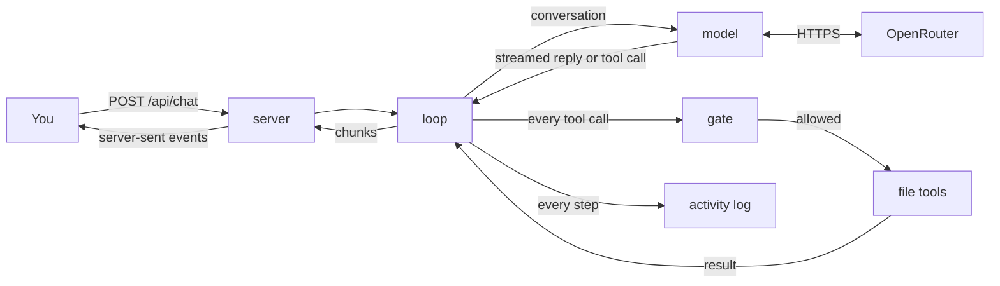

# Homunculus

An always-on personal agent that works toward your goals in its own sandbox and asks before anything leaves it.

> **Status:** early build. In place: the web console's chat screen, replies streamed word by word, and file tools in the agent's own workspace, each call checked by the gate. The plan and its progress are tracked in the [spec](https://github.com/umanggarg28/homunculus/issues/2) and its tickets.

## How it works



| Module | Job |
|---|---|
| `server` | HTTP API. Turns the reply into a stream of server-sent events. |
| `loop` | Asks the model, runs the tools it asks for, repeats until it answers in words. |
| `model` | One streaming call to the model through OpenRouter. |
| `gate` | Decides for every tool call whether it may run. Anything it cannot read is refused. |
| `tools` | `read`, `write`, `edit`, `list`, `search`, `delete` and `rename`, inside the agent's workspace only. |
| `activity` | An append-only record of every step, written by code, out of reach of every tool. |

The full design, including the modules still to come (sandbox, skills, wiki, waker), is in [ARCHITECTURE.md](ARCHITECTURE.md). [LEARN.md](LEARN.md) teaches the code one module at a time.

## Privacy

Every model request asks OpenRouter to route only to providers that keep no copy of the request and do not train on it (`provider: {"zdr": true, "data_collection": "deny"}`). It is fixed in code with no setting to turn it off, and a test fails if it is ever missing.

The server listens on `127.0.0.1` only, so nothing else on your network can reach it.

The agent's files live in a data directory outside this repository, `~/homunculus-data` by default (set `HOMUNCULUS_HOME` to change it). Its tools can only touch the `workspace` folder inside it: any path that leads outside, including through `..` or a symbolic link, is refused.

## Quick start

Requires [uv](https://docs.astral.sh/uv/) and an [OpenRouter](https://openrouter.ai) API key.

```bash
uv sync
export OPENROUTER_API_KEY=sk-or-...
uv run homunculus
```

**Manual check against the real model.** In a second terminal, send a message:

```bash
curl -N -X POST http://127.0.0.1:8765/api/chat \
  -H 'content-type: application/json' \
  -d '{"message": "Hello"}'
```

The check passes when the reply arrives as a series of `delta` events and ends with `done`. For example:

```
event: delta
data: {"text": "Hello"}

event: delta
data: {"text": "! How can I help?"}

event: done
data: {}
```

If the request fails, the stream ends with an `error` event that says why, for example `Model request failed (401): ...` for a wrong key.

To see a tool in use, send `"Save a note called tea.md that says I like green tea."`. The file appears in `~/homunculus-data/workspace/`, and the step is recorded in `~/homunculus-data/activity.jsonl`.

## The web console

The console is a React app in `web/`. Build it once, and the server serves it:

```bash
cd web && npm ci && npm run build && cd ..
uv run homunculus
```

Then open http://127.0.0.1:8765. While working on the console itself, `npm run dev` in `web/` serves it at http://127.0.0.1:5173 with live reload, and forwards `/api` to the server.

## Development

```bash
uv run pytest        # tests (no network access allowed)
uv run mypy          # type checks
uv run ruff check    # lint
uv run ruff format   # formatting
```

The same checks run on every pull request, along with a production build of the console.

## Stack and standards

- Python 3.12, FastAPI, httpx, managed with uv.
- The model is `z-ai/glm-5.3-flash` through OpenRouter's OpenAI-compatible chat completions API.
- Planned: [Agent Skills](https://agentskills.io) for skills, [MCP](https://modelcontextprotocol.io) for outside services, and an [LLM wiki](https://gist.github.com/karpathy/442a6bf555914893e9891c11519de94f) for memory.

## License

[MIT](LICENSE)
